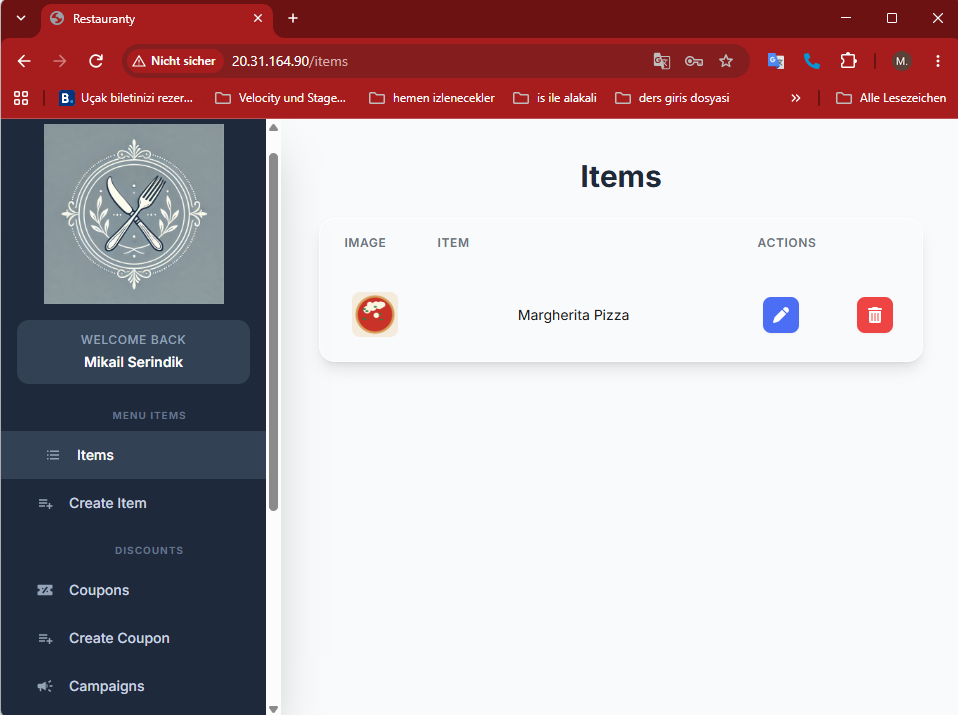
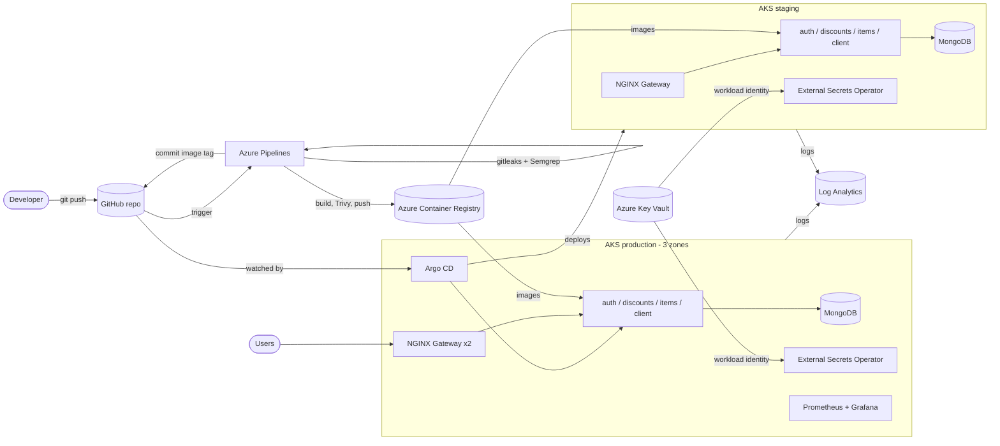
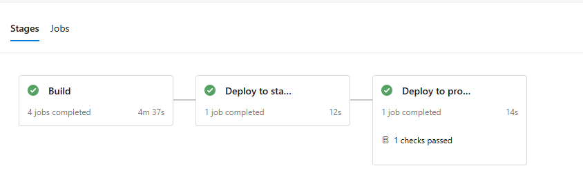
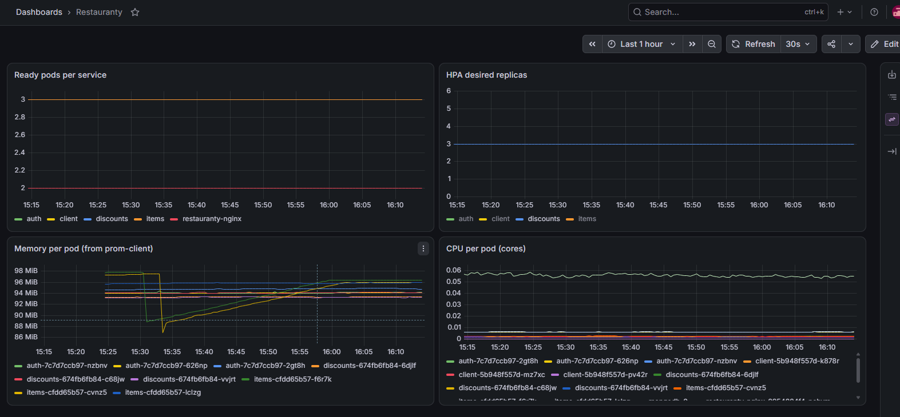
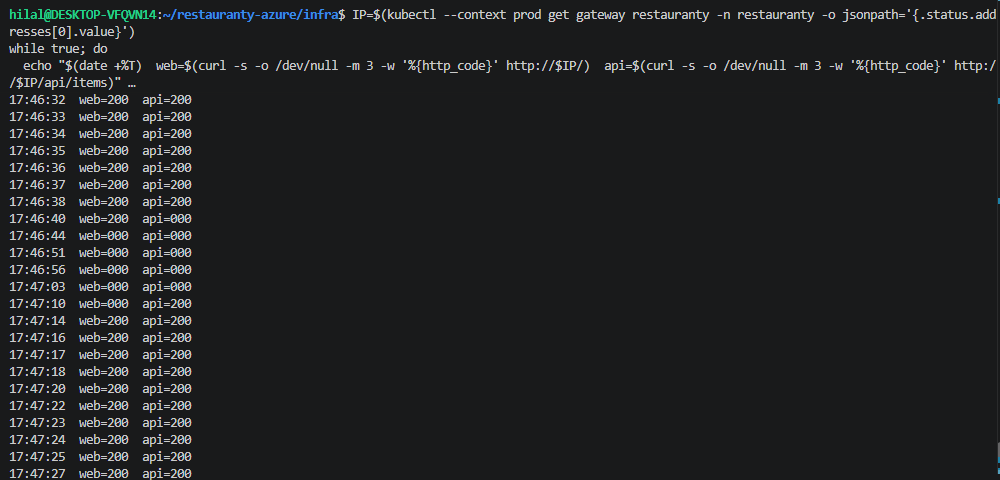

# Restauranty on Azure

Restauranty is a small restaurant management app made of three Node.js services (auth, discounts, items), a React frontend and MongoDB. This repository takes the app from "runs on my laptop" to **two AKS clusters (staging and production) on Azure**, built with Terraform, deployed with **GitOps (Argo CD)**, protected by a **DevSecOps pipeline in Azure DevOps**, and observed with **Prometheus, Grafana and Azure Monitor**.

Final project of the Ironhack DevOps & Cloud Computing bootcamp (Project 3, November 2026). The application code comes from [professordiogodev/devops.restauranty](https://github.com/professordiogodev/devops.restauranty); everything around it (containers, infrastructure, charts, pipeline, GitOps, security, monitoring) is my work.



## Architecture



Key ideas:

- **The pipeline never touches the clusters.** It builds and scans images, pushes them to ACR and writes the new image tag to Git. Argo CD, running inside the production cluster, sees the change and deploys it.
- **One Argo CD manages both clusters.** It runs in production and holds the staging credentials (the safer direction of the two).
- **No passwords anywhere.** The pipeline, External Secrets Operator and Terraform all authenticate with Entra ID identities (workload identity federation / Azure CLI login).

## Tech stack

| Area | Tools |
| --- | --- |
| Containers | Docker (multi-stage, non-root, read-only root filesystem), Docker Compose for local runs |
| Infrastructure as Code | Terraform (azurerm 4.x) with modules, remote state in Azure Storage with Entra ID auth |
| Kubernetes | AKS 1.36 (Azure CNI Overlay + Cilium), staging and production clusters |
| Packaging | Helm with a **library chart** shared by four service charts, published on GitHub Pages |
| Ingress | Gateway API + NGINX Gateway Fabric 2.8.1 |
| GitOps | Argo CD 3.6 with ApplicationSets (cluster and matrix generators) and an app-of-apps root |
| CI/CD | Azure Pipelines: gitleaks, Semgrep, build, Trivy, push, staging, manual approval, production |
| Secrets | Azure Key Vault + External Secrets Operator 2.14 (workload identity) |
| Observability | kube-prometheus-stack (Prometheus, Grafana, Alertmanager), Azure Monitor Container Insights + KQL |
| Planning | Azure Boards (Agile process), commits linked with `AB#<id>` |

## Repository layout

```
backend/           Node.js services (auth, discounts, items) - upstream code
client/            React frontend - upstream code
infra/             Terraform: resource group, ACR, Key Vault, Log Analytics, budget, AKS module
charts/            Helm charts: restauranty-lib (library), auth, discounts, items, client, mongodb
k8s/               Plain manifests for both clusters: namespace, Gateway, network policies, secret store
k8s/monitoring/    Production only: Grafana admin secret, ServiceMonitor, dashboard as code
argocd/            root-app.yaml and argocd/apps/ (ApplicationSets watched by the root app)
scripts/           shutdown.sh (evening teardown)
azure-pipelines.yml
docs/images/       Screenshots used in this README
```

## Environments

| | Staging | Production |
| --- | --- | --- |
| AKS cluster | `aks-hilal-restauranty-staging` | `aks-hilal-restauranty-prod` |
| Nodes | 2 x D2s_v7, one pool, no zones | System pool 2 x D2as_v7 (tainted) + user pool 3-4 x D2s_v6 across 3 zones |
| Replicas | 1 per service | HPA 3-6 per service, PodDisruptionBudget, zone spread |
| Gateway | 1 NGINX pod | 2 NGINX pods in different zones |
| Deploys | Automatically after every build | After manual approval in Azure DevOps |
| Monitoring | Azure Monitor logs | Azure Monitor logs + Prometheus/Grafana |

Each environment reads its image tag from its own values file (`values-staging.yaml`, `values-production.yaml`), so promotion is a one-line change in Git.

## CI/CD with GitOps



| Stage | What happens |
| --- | --- |
| Security scan | **gitleaks** scans the full Git history for secrets, **Semgrep** scans the code (JavaScript, Node.js, React rules). Any finding stops the pipeline. |
| Build | A matrix builds the four images, **Trivy** blocks CRITICAL vulnerabilities, images are pushed to ACR tagged with the short commit SHA. |
| Deploy to staging | Reads a GitHub token from Key Vault and commits the new tag to `values-staging.yaml` (`[skip ci]`). Argo CD deploys it. |
| Deploy to production | Waits for **manual approval** (configured on the `production` environment), then commits the same tag to `values-production.yaml`. |

**Build once, promote.** Images are built a single time; staging and production run the exact same image.

**Before and after GitOps.** In Project 2 GitHub Actions deployed to EKS with `kubectl apply`, so the pipeline needed cluster credentials and nobody noticed manual changes. Here the pipeline only writes to Git. Argo CD pulls from Git, reverts manual changes (self-heal, demonstrated by scaling a deployment by hand and watching Argo CD scale it back within seconds) and rebuilds both clusters from scratch every morning.

The pipeline identity (service connection) was reduced from `Contributor` on the resource group to `AcrPush` + `Reader` on ACR and `Key Vault Secrets User` on a single secret.

## Security

Summary (details and known limitations in [SECURITY.md](SECURITY.md)):

- Non-root containers with read-only root filesystems, dropped capabilities and seccomp profiles
- Secrets only in Key Vault; External Secrets Operator syncs them with workload identity
- Default-deny NetworkPolicies: internet → gateway → services → MongoDB only
- gitleaks, Semgrep and Trivy as pipeline gates; Trivy blocked a real CRITICAL CVE in the client image during the project
- Least-privilege identities for the pipeline and for External Secrets Operator

## Observability

- **Prometheus + Grafana** (production): a `ServiceMonitor` scrapes `/metrics` of the backends; the Restauranty dashboard (ready pods, HPA replicas, memory, CPU) is stored as a ConfigMap, so it survives the nightly rebuild.
- **Azure Monitor Container Insights** (both clusters): container logs and pod inventory in Log Analytics, kept for 30 days outside the clusters.



### How to view logs and metrics

```bash
# Grafana (password comes from Key Vault through the grafana-admin Secret)
kubectl --context prod -n monitoring get secret grafana-admin -o jsonpath="{.data.admin-password}" | base64 -d; echo
kubectl --context prod port-forward -n monitoring service/monitoring-grafana 3000:80
# http://localhost:3000 -> Dashboards -> Restauranty

# Prometheus targets
kubectl --context prod port-forward -n monitoring service/monitoring-kube-prometheus-prometheus 9090:9090
```

Log Analytics workspace `log-hilal-restauranty` → Logs:

```kusto
ContainerLogV2
| where TimeGenerated > ago(1h)
| where PodNamespace == "restauranty" and ContainerName == "auth"
| where LogMessage !contains "/metrics"
| project TimeGenerated, PodName, LogMessage
| order by TimeGenerated desc
```

## Resilience: zone failure test

I drained the production user node in `westeurope-2` while sending one request per second to the gateway.

- Every service kept at least two replicas (PodDisruptionBudget); replacements were running in the other zones within 18 seconds.
- The second NGINX replica moved to the free zone (required zone spread).
- About **30 seconds of partial request failures** while the Azure Load Balancer health probes (`externalTrafficPolicy: Local`) removed the drained node.
- Prometheus lost its history because it has no persistent disk; logs in Log Analytics were not affected.

Follow-ups: graceful shutdown (preStop) for NGINX and the services, a PDB for the gateway, persistent storage for Prometheus.



## Helm charts

`restauranty-lib` is a library chart with the shared Deployment, Service, HPA and PDB templates. Each service chart has four one-line templates that include it and keeps only its own values. Docs per chart are generated with **helm-docs** (`charts/*/README.md`).

The charts are published as a Helm repository on GitHub Pages:

```bash
helm repo add restauranty https://huluc.github.io/restauranty-azure
helm search repo restauranty
helm install auth restauranty/auth --version 0.1.0
```

## Run locally

```bash
# Create the .env files from the examples and fill in your values
for s in auth discounts items; do cp backend/$s/.env.example backend/$s/.env; done
docker compose up --build
# http://localhost:8000
```

### Environment variables (backends)

| Variable | Purpose | Source in AKS |
| --- | --- | --- |
| `SECRET` | JWT signing key, shared by the three services | Key Vault `jwt-secret` |
| `MONGODB_URI` | MongoDB connection string | Built by an ExternalSecret template from `mongodb-username` / `mongodb-password` |
| `CLOUD_NAME`, `CLOUD_API_KEY`, `CLOUD_API_SECRET` | Cloudinary image uploads | Key Vault `cloudinary-*` |

The client is built with `REACT_APP_SERVER_URL=/.`, so API calls are relative to whatever host serves the page.

## Deploy from scratch

Prerequisites: Azure CLI (logged in), Terraform, kubectl, Helm, the Argo CD CLI.

```bash
# 1) Infrastructure
cd infra && export ARM_SUBSCRIPTION_ID=$(az account show --query id -o tsv) && terraform apply && cd ..

# 2) Cluster credentials
az aks get-credentials -g rg-hilal-restauranty -n aks-hilal-restauranty-prod    --context prod    --overwrite-existing
az aks get-credentials -g rg-hilal-restauranty -n aks-hilal-restauranty-staging --context staging --overwrite-existing

# 3) Argo CD in production
helm repo add argo https://argoproj.github.io/argo-helm
helm install argocd argo/argo-cd --kube-context prod --version 10.17.0 \
  --namespace argocd --create-namespace --set dex.enabled=false --wait

# 4) Register the clusters (port-forward argocd-server to 8080 in another terminal first)
argocd login localhost:8080 --username admin --insecure
argocd cluster add staging --name staging --yes
argocd cluster set in-cluster --name production

# 5) Hand everything else to Argo CD
kubectl --context prod apply -f argocd/root-app.yaml
```

Argo CD then installs the Gateway API CRDs, NGINX Gateway Fabric, External Secrets Operator, the secrets, MongoDB, the four services and (in production) the monitoring stack.

Evening teardown (clusters only; ACR, Key Vault and Log Analytics stay):

```bash
./scripts/shutdown.sh
```

## Cost

Both clusters run about 12 hours a day and are deleted every evening. Estimated cost: about 14 EUR per day, about 85 EUR for the project. A budget alert (150 EUR/month, filtered by the `owner` tag) watches the subscription.

## Known limitations and next steps

- Chart and manifest changes (`charts/`, `k8s/`, `argocd/`) reach both clusters without approval; only image promotion is approved. Next step: branch protection with PR reviews and environment-specific Git paths.
- MongoDB is a single replica on a zone-bound disk; data is recreated every morning. Next step: replica set or a managed database, backups.
- Prometheus has no persistent storage.
- Graceful shutdown and a gateway PDB to remove the error window seen in the zone test.
- Argo CD uses the built-in admin account; next step is Entra ID SSO.
- Alert notifications (Alertmanager receivers) are not configured.
